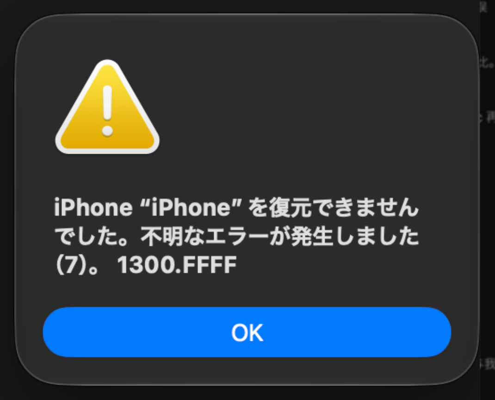

# iPhone 16 刷机报错「未知错误 (7) / 1300.FFFF」深度逆向分析与零按键修复方案

本仓库记录了一次针对 **iPhone 16 (`iPhone17,3` / `d47ap` / A18 `t8140`)** 在 macOS 上通过 Finder 恢复固件（从 `iBoot-11881.80.57` 升级/恢复至 `27.2.1` Build `24B156`）时，反复卡在进度条 `5%` 并报错 **「无法恢复 iPhone。发生未知错误 (7)。[1300.FFFF]」**、且退出后**手机屏幕彻底全黑不亮**的完整排查、ARM64e 逆向反编译与修复过程。

---

## 目录

1. [故障现象与表象迷惑](#一故障现象与表象迷惑)
2. [命令行底层状态诊断（无需第三方工具）](#二命令行底层状态诊断无需第三方工具)
3. [核心破案一：为什么手机处于恢复模式但屏幕彻底全黑？](#三核心破案一为什么手机处于恢复模式但屏幕彻底全黑)
4. [核心破案二：为什么「按进 DFU 模式」完全无效？（反编译证实）](#四核心破案二为什么按进-dfu-模式完全无效反编译证实)
5. [核心破案三：逆向 `restored_update` 定位 `1300.FFFF` (`0xe00002e9`) 真凶](#五核心破案三逆向-restored_update-定位-1300ffff-0xe00002e9-真凶)
6. [柳暗花明：在 `MobileDevice.framework` 与 `restored_update` 中发现苹果隐藏后门 `iBootEANNuke`](#六柳暗花明在-mobiledeviceframework-与-restored_update-中发现苹果隐藏后门-ibooteannuke)
7. [零按键修复方案：修改本地 IPSW `BuildManifest.plist` 触发 `iBootEANNuke`](#七零按键修复方案修改本地-ipsw-buildmanifestplist-触发-ibooteannuke)
8. [仓库工具与脚本说明](#八仓库工具与脚本说明)

---
 
## 一、故障现象与表象迷惑

### 1.1 表面现象
1. **第一阶段（卡死在进度条）**：使用 Mac 连接 iPhone 16 恢复固件时，手机屏幕停留在苹果 Logo + 进度条（约 5% 位置）一动不动。
2. **第二阶段（弹窗报错 `1300.FFFF`）**：Mac 端 Finder 弹出提示：
   > **无法恢复“iPhone”。发生未知错误 (7)。**
   > 附加错误指纹：`1300.FFFF`
3. **第三阶段（强制重启后全黑“假死”）**：尝试强制重启或按键退出卡死界面后，**手机屏幕彻底全黑，没有任何背光、没有苹果 Logo、也没有恢复模式的「数据线+电脑」图标**，让人误以为手机已经不开机或进了 DFU，但在盲按进 DFU 时却怎么按都按不进去。

### 1.2 网上常规建议的误区
搜索「未知错误 (7) / 1300.FFFF」，常规教程通常归结为：
- 更换数据线 / 更换 USB 接口；
- 手动按键进入 **DFU 模式** 重刷；
- 主板 NAND 硬盘虚焊损坏。

然而通过提取 macOS 底层恢复日志并反编译固件内的 Ramdisk 刷机程序，我们发现上述常规建议在本案例中要么解释不了现象，要么（如拼命按键进 DFU）**在代码层面根本不会改变任何执行路径**。

---

## 二、命令行底层状态诊断（无需第三方工具）

在手机屏幕全黑或卡在进度条时，可以通过 macOS 原生命令行直接透视设备的真实状态：

### 2.1 通过 `ioreg` 判断手机所处的真实 USB 阶段

运行命令：
```bash
ioreg -p IOUSB -l -w 0 | grep -E "kUSBProductString|idProduct|kUSBSerialNumberString"
```

根据 Apple USB Vendor ID (`0x05ac` = `1452`) 下的 `idProduct` 即可精确区分 4 种状态：

| `idProduct` (十进制) | `idProduct` (十六进制) | `kUSBProductString` | 真实状态说明 |
|---|---|---|---|
| `4776` | `0x12a8` | `iPhone` | 正常 iOS 系统开机状态 |
| `4780` | `0x12ac` | `iPhone` (带 `NCM Control` 虚拟网卡 `anpi0`) | **RestoreOS (刷机临时内存系统 Ramdisk)**。如果此时 `ifconfig anpi0` 为 `inactive`，说明后台刷机进程早已报错断开，手机只是死锁停留在进度条画面 |
| `4737` | `0x1281` | `Apple Mobile Device (Recovery Mode)` | **普通恢复模式 (iBoot)** |
| `4647` | `0x1227` | `Apple Mobile Device (DFU Mode)` | **真正的硬件级 DFU 模式 (SecureROM)** |

### 2.2 通过 `libusb` 直接向处于恢复模式的 iPhone 发送 iBoot 控制指令

当手机处于 `0x1281`（Recovery Mode）时，无需按键，直接使用 Python 调用 `/opt/homebrew/lib/libusb-1.0.dylib` 向 USB 端点发送 Control Transfer (`bmRequestType = 0x40` 发送命令，`0xC0` 读取返回)，即可直接读取手机内部 iBoot 的环境变量（详见 [`scripts/check_iphone_status.py`](scripts/check_iphone_status.py)）：

```text
Opened iBoot Recovery Mode device via libusb!
build-version   = 'iBoot-11881.80.57'   # 手机当前闪存内的引导层版本（对应 iOS 18.3）
build-style     = 'RELEASE'
auto-boot       = 'false'
boot-command    = 'fsboot'
boot-device     = 'nvme_nand0'
config_board    = 'd47'
restore-outcome = 'recovery_mode'
```

由此确认：手机底层的 NAND 闪存引导层还停留在 **iOS 18.3 (`iBoot-11881.80.57`)**，而正在刷入的目标固件是 **`27.2.1` (`24B156`, `mBoot-20457.42.5`)**。

---

## 三、核心破案一：为什么手机处于恢复模式但屏幕彻底全黑？

检查 `ioreg` 发现手机明明处于 `Apple Mobile Device (Recovery Mode)` (`idProduct = 4737`)，但手机屏幕却**完全漆黑，既没有苹果 Logo 也没有数据线图标**。

翻阅 `~/Library/Logs/iPhone Updater Logs/iPhoneUpdater-1.log` 后真相大白：

1. 在现代 Apple Silicon iPhone（如 iPhone 16 `t8140`）中，开机引导阶段的以下 **6 个关键底层固件**被标记为 `IsiBootEANFirmware`，存放在 NVMe 闪存专用的 **EAN (Exclave / Early Access NAND) 命名空间**中：
   - `WCHFirmwareUpdater`（无线充电固件，246 KB）
   - `RecoveryMode`（**恢复模式屏幕上的电脑+数据线图标**，2.62 MB）
   - `Liquid`（进水检测图标，1.03 MB）
   - **`DCP`（Display Co-Processor，屏幕显示协处理器驱动固件，2.58 MB！）**
   - `Ap,LowPowerMode`（低电量图标，1.26 MB）
   - **`AppleLogo`（开机苹果 Logo 图像，30 KB！）**

2. 在刷机日志第 2561–2564 行（`format_ean_storage` 阶段），刷机程序先执行了：
   ```text
   [20:41:43.0332] entering format_ean_storage
   [20:41:43.0332] EAN storage is already formatted
   [20:41:43.0332] Cleaning EAN images
   [20:41:43.0332] EAN storage cleaned successfully
   ```
   **这一步把 EAN 分区里旧的图标和 `DCP` 显示协处理器固件清理掉了！**

3. 紧接着在第 9340–9383 行（`update_iBoot` 阶段），当刷机程序准备把新的 6 个 `IsiBootEANFirmware`（打包为 `ifw2`，共 `7,815,168` 字节）写回 EAN 分区时，发生了 `0xe00002e9` 错误并中断退出！

4. **结论**：因为旧的 `DCP`（屏幕显示协处理器固件）和恢复模式图标已被清空，而新的又没写进去，所以手机重启回到 `iBoot` 恢复模式时，**根本没有显示驱动和图标可用，屏幕只能保持 100% 纯黑**！这也导致用户在尝试手动按进 DFU 时，失去了“观察屏幕熄灭那一刻”的视觉参照。

---

## 四、核心破案二：为什么「按进 DFU 模式」完全无效？（反编译证实）

很多教程建议在遇到未知错误 (7) 时“手动按进 DFU 模式重刷”。但我们直接解包了 IPSW 固件包中的刷机内存盘 `141-09491-250.dmg`（剥离前 27 字节 `IM4P` 头部后即为未加密的 APFS 容器），提取并反编译了手机端刷机主程序 `/usr/local/bin/restored_update`。

在 `restored_update` 的 `format_ean_storage` 函数（地址 `0x100029560`）中，ARM64e 反汇编代码如下（详见 [`docs/disassembly-analysis.md`](docs/disassembly-analysis.md)）：

```armasm
; 调用 AppleNVMeEAN 驱动的 selector 0 (isFormatted)
0000000100029574    mov w1, #0x0
0000000100029580    bl  _IOConnectCallScalarMethod
0000000100029584    cbz w0, 0x1000295cc
...
00000001000295cc    ldr x8, [sp, #0x10]      ; 读取返回的 isFormatted 布尔值
00000001000295d0    cbz x8, 0x100029604      ; 只有 isFormatted == 0 时才跳转到 0x100029604 执行格式化 (selector 1)！
00000001000295d4    adrp x0, 438
00000001000295d8    add  x0, x0, #0x7ca      ; "EAN storage is already formatted\n"
00000001000295dc    bl   0x1000115ac
...
0000000100029634    adrp x0, 438
0000000100029638    add  x0, x0, #0x819      ; "Cleaning EAN images\n"
0000000100029644    mov  w1, #0x9            ; 调用 AppleNVMeEAN selector 9 (cleanImages)
0000000100029658    bl   _IOConnectCallScalarMethod
```

**反编译结论**：
1. 无论你是从 **Recovery Mode (`0x1281`)** 还是 **DFU Mode (`0x1227`)** 开始刷机，Mac 都会把手机引导进**同一个 `restored_update` 内存盘环境**。
2. `format_ean_storage` **没有任何针对 DFU 模式的判断分支**！只要 NVMe 控制器的 `selector 0` 返回 `isFormatted != 0`，它就永远打印 `EAN storage is already formatted`，只调用 `selector 9` (`Cleaning EAN images`)，绝不会调用 `selector 1` 重新格式化 EAN 分区。
3. 因此，**费尽周折按进 DFU 模式对解决此问题毫无帮助**。

---

## 五、核心破案三：逆向 `restored_update` 定位 `1300.FFFF` (`0xe00002e9`) 真凶

在恢复日志末尾，错误堆栈如下：

```text
[20:41:48.0691] Writing out IsiBootEANFirmware files to EAN iBoot keys.
[20:41:48.0691] Reading EAN key ifw1.
[20:41:48.0691] read failed, kernResult = 0xe00002e9.
[20:41:48.0691] Key not found.
[20:41:48.0691] Reading EAN key ifw2.
[20:41:48.0691] Will use Generation 3.
[20:41:48.0691] Reading EAN key ifw2.
[20:41:48.0691] ifw2 hash does not match boot hash - using ifw2 to stage new data.
[20:41:48.0691] Writing EAN key ifw2, (1 of 1) imageSize=7815168
[20:41:48.0691] _write_ean_image failed kernResult=0xe00002e9
[20:41:48.0691] Failed to write to EAN namespace
[20:41:48.0691] _write_ibfw failed.
[20:41:48.0691] Update[iBoot] error - Error Domain=RamrodErrorDomain Code=7 "Generic updater error: -1"
[20:41:48.0691] CHECKPOINT FAILURE:(FAILURE:-1) FIRMWARE:[0x1300] update_iBoot [0]D(Generic updater error: -1)
```

反编译 `restored_update` 的 `update_iBoot` 函数（`0x100057930`–`0x100057b30`）后，我们还原了它的完整逻辑缺陷：

1. **双槽位设计 (`ifw1` 与 `ifw2`)**：
   EAN 分区使用 `ifw1`（主槽位）和 `ifw2`（暂存槽位）存放打包后的 6 个 `IsiBootEANFirmware` 镜像（在 `24B156` 中总大小为 **`7,815,168` 字节 ≈ 7.81 MB**）。
2. **异常残留状态**：
   在这台手机的 EAN 分区中，`ifw1` 不存在（`Key not found`），但 **`ifw2` 已经存在**（来自此前未完成的更新/恢复，且 `Cleaning EAN images` 不会删除 `ifw1`/`ifw2`）。
3. **先写后删导致的死锁 (`0x100057aa0`)**：
   当 `restored_update` 检测到 `ifw2` 的哈希与当前 USB 引导的 `BootManifestHash` 不一致时，打印：
   `ifw2 hash does not match boot hash - using ifw2 to stage new data.`
   随后在 `0x100057aa0`：
   ```armasm
   0000000100057aa0    bl  0x100051ba8          ; 先调用 _write_ean_image 写入 7.81 MB 的新 "ifw2"！
   0000000100057aa4    cbz w0, 0x100057ae8      ; 一旦写入失败，直接跳转到 _write_ibfw failed 报错退出！
   0000000100057aa8    mov x0, x27
   0000000100057aac    bl  0x100051d14          ; 写入成功之后，才去调用 _erase_ean_image (selector 3) 擦除旧键值！
   ```
   因为旧的 `ifw2` 仍然占着 iOS 18 时期创建的 EAN 空间（或者 `ifw2` 所在块存在坏块），`AppleNVMeEAN` 驱动在执行 `selector 2` (`writeImage`, `imageSize=7815168`) 时无法分配/覆写该 7.81 MB 镜像，直接返回内核错误 **`0xe00002e9` (`kIOReturnDeviceError`)**！

---

## 六、柳暗花明：在 `MobileDevice.framework` 与 `restored_update` 中发现苹果隐藏后门 `iBootEANNuke`

继续向下反编译 `restored_update` 的 `update_iBoot` 函数（地址 `0x100057cf4`–`0x100057d30`）时，我们发现了一段极其关键的代码：

```armasm
0000000100057cf4    ldr  x0, [x28, #0x8]     ; 读取 options 字典
0000000100057cf8    cbz  x0, 0x100057d34
0000000100057cfc    adrp x1, 647
0000000100057d00    add  x1, x1, #0x758      ; CFString @"iBootEANNuke"
0000000100057d04    mov  w2, #0x0
0000000100057d08    bl   _AMSupportCFDictionaryGetBoolean
0000000100057d0c    cbz  w0, 0x100057d34     ; 如果 iBootEANNuke == true:
0000000100057d10    adrp x0, 416
0000000100057d14    add  x0, x0, #0x4d8      ; 打印 "Nuking iBootEAN keys.\n"
0000000100057d18    bl   0x1000115ac
0000000100057d1c    adrp x0, 647
0000000100057d20    add  x0, x0, #0x778      ; @"ifw1"
0000000100057d24    bl   0x100051e84         ; 强制擦除 EAN 中的 "ifw1"！
0000000100057d28    adrp x0, 647
0000000100057d2c    add  x0, x0, #0x798      ; @"ifw2"
0000000100057d30    bl   0x100051e84         ; 强制擦除 EAN 中的 "ifw2"！
```

那么，**怎样才能让 Mac 给手机发送 `iBootEANNuke = true` 呢？**

我们反编译了 macOS 系统上的 `/Library/Apple/System/Library/PrivateFrameworks/MobileDevice.framework/Versions/A/MobileDevice`（`arm64e` 切片，地址 `0x15936c`–`0x1593b8`）：

```armasm
000000000015937c    bl   _AMAuthInstallBundleCopyPersonalizediBootEANFirmwareURLs
0000000000159380    cbnz w0, 0x1593b8
0000000000159384    ldr  x0, [sp, #0x48]
0000000000159388    cbz  x0, 0x1593b8
000000000015938c    bl   _CFDictionaryGetCount
0000000000159390    cbnz x0, 0x1593b8        ; 如果 IsiBootEANFirmware 文件数量 == 0：
0000000000159394    adrp x1, 841
0000000000159398    add  x1, x1, #0x8d0      ; @"iBootEANNuke"
000000000015939c    mov  x0, x23             ; restoreOptions 字典
00000000001593a0    ldr  x2, [sp, #0x20]     ; kCFBooleanTrue
00000000001593a4    bl   _CFDictionarySetValue
00000000001593a8    adrp x1, 841
00000000001593ac    add  x1, x1, #0x8f0      ; "Setting kAMRestoreOptionsiBootEANNuke."
00000000001593b0    mov  w0, #0x6
00000000001593b4    bl   _AMRLog
```

**完整的触发链条**：
1. Mac 端的 `_AMAuthInstallBundleCopyPersonalizediBootEANFirmwareURLs` 会扫描 IPSW 固件包内 `BuildManifest.plist` 中所有包含 `<key>IsiBootEANFirmware</key><true/>` 的组件。
2. 当该函数返回的字典元素个数为 `0`（即 `BuildManifest.plist` 中没有任何组件标记 `IsiBootEANFirmware = true`）时：
   - **Mac 端**：自动在 `restoreOptions` 中设置 **`iBootEANNuke = true`**！
   - **手机端**：
     1. 在 `0x100057920` (`cmp x0, #0x1; b.lt 0x100057a20`) 因文件数为 0，**直接跳过报错的 `_write_ean_image` 步骤**；
     2. 在 `0x100057d08` 检测到 `iBootEANNuke == true`，打印 **`Nuking iBootEAN keys.`** 并调用 `0x100051e84` **将卡死在 EAN 分区里的 `ifw1` 和 `ifw2` 彻底擦除**；
     3. 随后继续在 `0x100057d34` 刷入主 `iBoot` (`LLB` + `iBoot`) 与 `SEP` 固件，顺利走完整个恢复流程！

---

## 七、零按键修复方案：修改本地 IPSW `BuildManifest.plist` 触发 `iBootEANNuke`

### 7.1 为什么修改 `BuildManifest.plist` 中的 `IsiBootEANFirmware` 不会破坏苹果签名？
- Apple TSS 服务器（`gs.apple.com`）在签发 `APTicket`（SHSH 签名）时，只校验请求中各固件组件的 SHA-384 `Digest` 摘要与设备 ECID/ApNonce。
- `BuildManifest.plist` 位于 `.ipsw`（本质是 ZIP 归档）最外层，本身没有数字签名；其中每个组件下的 `Info -> IsiBootEANFirmware` 仅是供给本地 `MobileDevice.framework` 进行分类打包的元数据，**根本不会发送给苹果 TSS 服务器**。
- 因此，保持所有组件的 `Digest` 与 `Personalize` 不变，仅将 `IsiBootEANFirmware`（及 `IsiBootNonEssentialFirmware`）改为 `<false/>`，既能获得 100% 合法的 Apple 官方 `APTicket` 签名，又能激活 `iBootEANNuke`！

### 7.2 两种补丁模式（由 [`scripts/patch_ipsw_ean.py`](scripts/patch_ipsw_ean.py) 自动生成）

我们的补丁脚本利用 macOS APFS 文件系统的写时复制克隆（`cp -c`，克隆 12.8 GB 文件仅需 **0.01 秒**且**不占额外磁盘空间**），并通过原地重写 ZIP 中央目录（无需重新压缩 12.8 GB 数据，耗时 **< 0.1 秒**）生成两个修复版固件包：

1. **模式 A：`nuke`（彻底跳过 EAN 写入 + 触发 `iBootEANNuke` 清空 `ifw1`/`ifw2`）**
   - 将所有 `IsiBootEANFirmware` 和 `IsiBootNonEssentialFirmware` 设为 `false`。
   - 作用：强制触发 `Setting kAMRestoreOptionsiBootEANNuke.` 与 `Nuking iBootEAN keys.`，绕过 `0xe00002e9` 错误并清空残留的 `ifw2`。
2. **模式 B：`minimal`（仅保留 `AppleLogo` 30 KB，或 `AppleLogo` + `DCP` 屏幕驱动）**
   - 仿照 `BuildManifest.plist` 中 `Recovery Customer Install` 的做法，将 `ifw2` 写入体积从 `7.81 MB` 压缩到 `30 KB`（或 `2.61 MB`），解决因旧版 EAN 分区剩余空间不足以同时容纳新旧两个 7.81 MB 镜像而导致的 `0xe00002e9` 错误。

### 7.3 操作步骤（全程无需按手机任何按键）
1. 运行补丁脚本生成修复版 `.ipsw`：
   ```bash
   python3 scripts/patch_ipsw_ean.py \
     --input "~/Library/iTunes/iPhone Software Updates/iPhone17,3_27.2.1_24B156_Restore.ipsw" \
     --output ~/Desktop/iPhone17,3_27.2.1_24B156_EANNuke.ipsw \
     --mode nuke
   ```
2. 打开 Mac 的 **Finder（访达）**，在左侧边栏点击处于恢复模式的 **iPhone**。
3. **按住 Mac 键盘上的 `Option (⌥)` 键不放**，用鼠标点击 **「恢复 iPhone...」**。
4. 在弹出的文件选择框中，选择生成的 `iPhone17,3_27.2.1_24B156_EANNuke.ipsw` 开始刷机。
5. （可选）如果在 `nuke` 模式成功清空 `ifw1`/`ifw2` 并完成恢复后，希望重新写入完整的开机 Logo 与 `DCP` 引导驱动，可再用原版（或 `minimal` 版）固件刷入一次。

---

## 八、仓库工具与脚本说明

- [`docs/disassembly-analysis.md`](docs/disassembly-analysis.md)：`restored_update` 与 `MobileDevice.framework` 关键函数的完整 ARM64e 反汇编与 C 伪代码还原。
- [`docs/restore-log-analysis.md`](docs/restore-log-analysis.md)：`iPhoneUpdater.log` 恢复日志时间线与 `1300.FFFF` 检查点解析。
- [`scripts/check_iphone_status.py`](scripts/check_iphone_status.py)：通过 `ioreg` 与 `libusb` 直接检测 iPhone 当前模式、读取 `iBoot` 环境变量（无需按键）。
- [`scripts/patch_ipsw_ean.py`](scripts/patch_ipsw_ean.py)：零空间占用、毫秒级原地修改 IPSW `BuildManifest.plist` 以启用 `iBootEANNuke` 或精简 EAN 镜像的工具。
- [`scripts/dfu_voice_assistant.py`](scripts/dfu_voice_assistant.py)：当手机屏幕因 EAN 清空而全黑时，利用 macOS `ioreg` 毫秒级轮询 + `say` 中文语音合成实现的盲按读秒辅助脚本。
